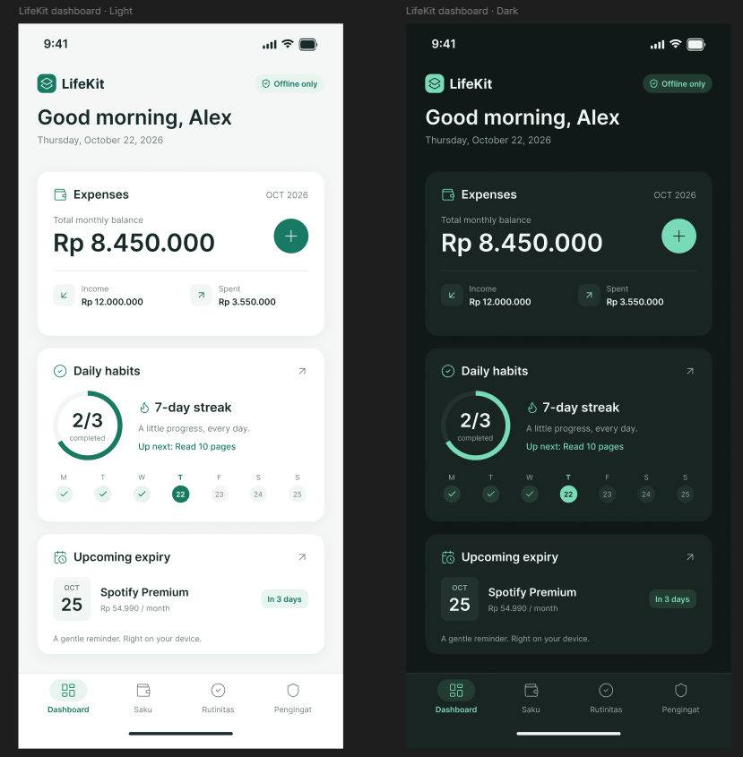
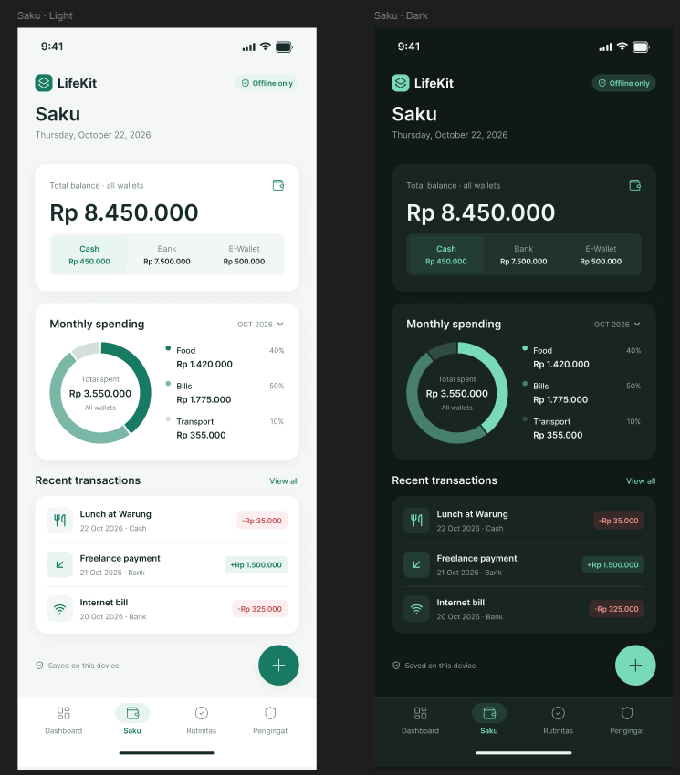

# LifeKit

LifeKit adalah aplikasi mobile **offline-first** untuk mengelola keuangan, rutinitas harian, dan pengingat tagihan dalam satu tempat. Semua data disimpan lokal di perangkat (SQLite), tanpa akun dan tanpa server.

Dibangun dengan **Expo (SDK 58)**, **React Native**, **Expo Router**, **Zustand**, dan **expo-sqlite**. Mendukung tema **Light** dan **Dark**.

---

## 📱 Screenshots

<div align="center">
  
  &nbsp;&nbsp;
  
</div>

---

## Fitur

| Modul | Deskripsi |
| --- | --- |
| **Dashboard** | Ringkasan saldo bulanan, progres rutinitas hari ini, dan tagihan terdekat. |
| **Saku** | Pencatatan pemasukan dan pengeluaran per dompet (Cash, Bank, E-Wallet), ringkasan donut kategori, filter dompet, dan navigasi bulan. |
| **Rutinitas** | Habit tracker dengan checklist harian, streak, target mingguan, kategori ibadah/spiritual yang netral agama, dan pengingat jam terjadwal. |
| **Pengingat** | Pelacak langganan dan tagihan (bulanan/tahunan), total komitmen bulanan, dan hitung mundur jatuh tempo. |

## Teknologi

- [Expo](https://docs.expo.dev/) ~58 dan [Expo Router](https://docs.expo.dev/router/introduction/) (file-based routing)
- React Native 0.88 dan React 19
- [Zustand](https://github.com/pmndrs/zustand) untuk state management
- [expo-sqlite](https://docs.expo.dev/versions/latest/sdk/sqlite/) untuk penyimpanan lokal
- [expo-notifications](https://docs.expo.dev/versions/latest/sdk/notifications/) untuk notifikasi lokal
- TypeScript (strict mode)

## Struktur Proyek

```text
lifekit/
├── app/                      # Route (Expo Router)
│   ├── _layout.tsx           # Root layout
│   └── (tabs)/               # Tab: index, saku, rutinitas, pengingat
├── src/
│   ├── core/
│   │   ├── database/         # Koneksi & skema SQLite
│   │   ├── theme/            # Token warna & tema
│   │   └── services/         # Layanan lintas fitur (notifikasi)
│   └── features/
│       ├── dashboard/        # Komponen Dashboard
│       ├── saku/             # components, repositories, stores, types, utils
│       ├── rutinitas/        # components, repositories, services, stores, types
│       └── pengingat/        # components, repositories, stores, types
├── assets/
│   └── screenshots/          # Screenshot aplikasi
├── components/
└── constants/
```

Setiap fitur mengikuti pola yang sama: **UI (components) → Zustand store → repository (SQLite)**.

## Memulai

### Prasyarat

- Node.js LTS
- npm (atau yarn)
- HP/emulator Android atau iOS
- [Expo Go](https://expo.dev/go) untuk uji cepat, atau development build (lihat catatan notifikasi di bawah)

### Instalasi

```bash
git clone https://github.com/SyahrulCM/lifekit.git
cd lifekit
npm install
```

### Menjalankan

```bash
npx expo start        # jalankan dev server
npx expo start --android
npx expo start --ios
```

### Perintah berguna

```bash
npx tsc --noEmit      # typecheck
npx expo lint         # lint
npx expo-doctor       # diagnosa dependensi
npx expo install --fix  # samakan versi paket dengan SDK
```

## Catatan Notifikasi

Aplikasi hanya memakai **notifikasi lokal**. Notifikasi push jarak jauh (remote) tidak tersedia di Expo Go Android sejak SDK 53. Jika muncul error `Cannot find native module 'ExpoTopicSubscriptionModule'`, gunakan **development build**:

```bash
npx expo run:android
# atau lewat EAS
npx eas-cli@latest build --profile development --platform android
```

Konfigurasi build ada di [`eas.json`](./eas.json).

## Penyimpanan Data

Semua data tersimpan di database SQLite lokal (`lifekit.db`) dengan tabel `transactions`, `habits`, `habit_logs`, dan `subscriptions`. Menghapus aplikasi akan menghapus datanya, jadi buat cadangan terlebih dahulu bila diperlukan.

## Lisensi

Proyek ini dilisensikan di bawah [MIT License](./LICENSE).
